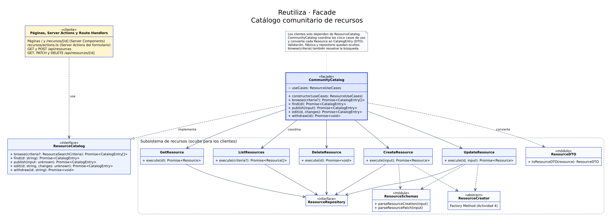
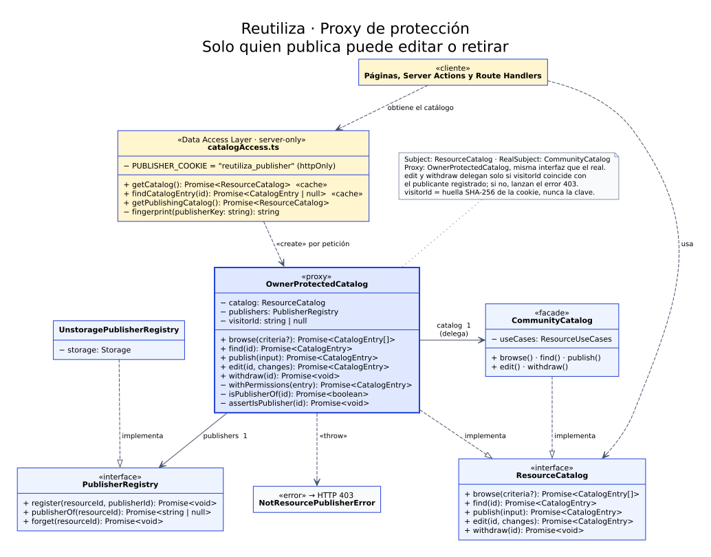
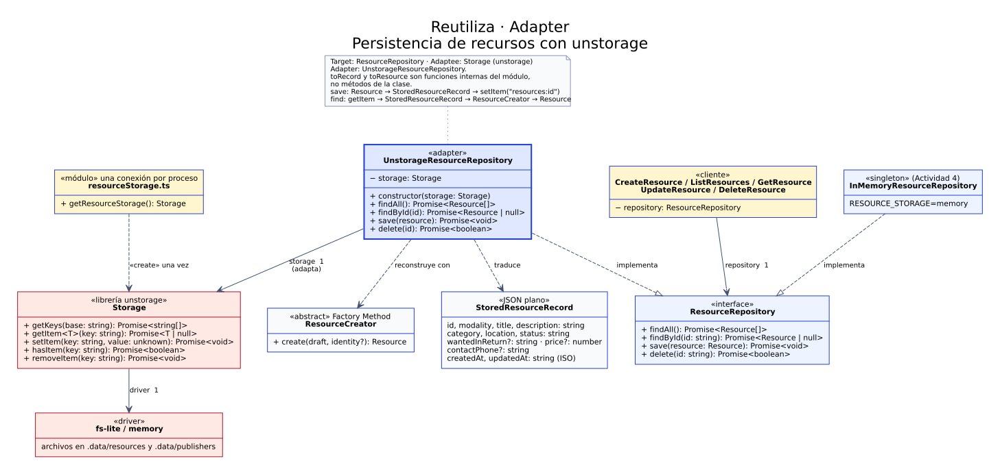
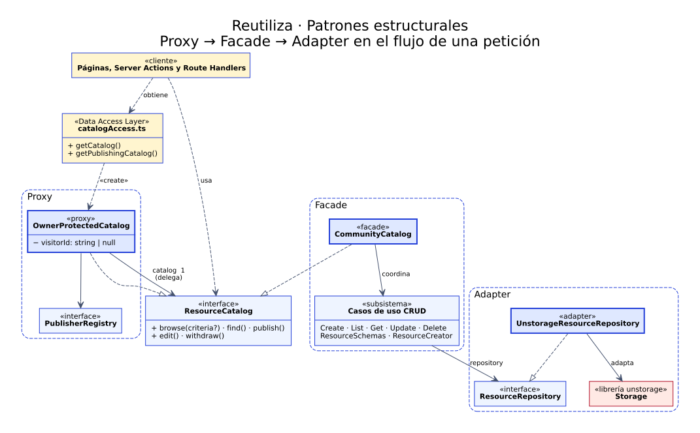

# Reutiliza: patrones estructurales

**PADISOFT · Patrones estructurales**

## 1. Contexto y objetivo

Reutiliza permite publicar objetos, materiales y productos para donarlos, intercambiarlos o venderlos a un precio solidario. La primera entrega construyó el CRUD de recursos sobre una arquitectura de monolito modular con Next.js y aplicó dos patrones creacionales: **Factory Method**, para construir cada modalidad con sus reglas, y **Singleton**, para compartir el almacén en memoria.

Esta entrega identifica tres problemas del proyecto resultante y los resuelve con tres patrones estructurales: **Facade**, **Proxy** y **Adapter**. Los tres se encadenan en el recorrido de una petición: el Proxy protege, la Fachada coordina y el Adapter persiste.

## 2. Parte A: problemas y justificación

### 2.1 Problema 1: los puntos de entrada conocen todo el subsistema → Facade

**Situación.** La página principal y los cinco Route Handlers (`GET` y `POST /api/resources`; `GET`, `PATCH` y `DELETE /api/resources/[id]`) repetían la misma coordinación: elegir el caso de uso, ejecutarlo y transformar la entidad con `toResourceDTO`. Cada punto de entrada dependía de cinco clases de aplicación, de la función de serialización y de la raíz de composición.

**Consecuencia.** Cualquier cambio en el subsistema obligaba a revisar todos los puntos de entrada. Una pantalla o Server Action nueva habría vuelto a copiar la coordinación, y no existía un lugar donde aplicar una regla común a todas las operaciones del catálogo, como el control de propiedad del problema 2.

**Patrón aplicado.** Facade proporciona una interfaz unificada y simplificada a un conjunto de interfaces de un subsistema. `CommunityCatalog` expone cinco operaciones en el lenguaje del negocio (`browse`, `find`, `publish`, `edit` y `withdraw`) y encapsula los casos de uso, la validación con Zod, el Factory Method, el repositorio y la conversión a DTO. `browse` acepta criterios de búsqueda (texto, categoría y estados), que la Fachada entrega al caso de uso `ListResources`.

**Por qué resuelve el problema.**

- Los puntos de entrada dependen de una sola abstracción, `ResourceCatalog`, y no de los cinco casos de uso. Cada Route Handler quedó reducido a leer la petición, invocar una operación y traducir el resultado a HTTP.
- La conversión a `CatalogEntry` se hace en un único lugar. La página y la API devuelven la misma representación.
- La Fachada no reemplaza el subsistema: los casos de uso conservan su responsabilidad y siguen disponibles para las pruebas.
- La interfaz se amplió con clientes nuevos sin tocar el subsistema: la página de detalle, el buscador y las Server Actions del formulario usan las mismas cinco operaciones.
- Al existir un punto de entrada común con una interfaz propia, es posible anteponerle un Proxy sin modificar a los clientes, como se hace en el problema 2.

**Alternativas consideradas.** Un módulo de funciones auxiliares eliminaría la duplicación, pero no ofrecería una interfaz sustituible. Mediator coordina colaboraciones entre objetos que se comunican entre sí; aquí el subsistema no necesita comunicarse internamente, solo ofrecer una entrada simple.

### 2.2 Problema 2: cualquier visitante puede modificar publicaciones ajenas → Proxy de protección

**Situación.** La API aceptaba `PATCH` y `DELETE` sobre cualquier recurso. Bastaba conocer el identificador, visible en el catálogo, para cambiar el título o el precio de una publicación ajena o eliminarla. El informe de la Actividad 4 lo registró como limitación ("ausencia de control de propiedad").

**Consecuencia.** En una plataforma de intercambio entre desconocidos, esa ausencia permite sabotear publicaciones y resta confianza al servicio. La regla de acceso tampoco pertenece a los casos de uso ni a la Fachada: mezclarla con la coordinación del CRUD violaría la responsabilidad única de esas clases.

**Patrón aplicado.** Proxy proporciona un sustituto de otro objeto para controlar el acceso a él. `OwnerProtectedCatalog` implementa la misma interfaz `ResourceCatalog` que la Fachada y la envuelve:

- `publish` registra al visitante como publicante del recurso creado.
- `edit` y `withdraw` comprueban que el visitante sea quien publicó el recurso antes de delegar. Si no lo es, lanzan `NotResourcePublisherError`, que la API traduce a HTTP 403.
- `browse` y `find` delegan sin restricción y agregan `canManage` a cada entrada, para que la interfaz muestre las acciones de editar y retirar solo a quien corresponde.

El visitante se identifica con una clave anónima aleatoria, guardada en una cookie `httpOnly`. En el almacén solo se registra su huella SHA-256.

**Por qué resuelve el problema.**

- El control de acceso queda en una clase dedicada, sin modificar la Fachada ni los casos de uso (principio abierto/cerrado).
- Al compartir la interfaz `ResourceCatalog`, los clientes no distinguen entre el catálogo real y el protegido.
- La verificación se ejecuta antes de delegar: una petición rechazada no llega al subsistema ni modifica datos.
- Si el recurso no existe, el Proxy conserva la respuesta 404 del catálogo real y solo informa 403 cuando el recurso existe y pertenece a otra persona.

**Alternativas consideradas.** Un Decorator también envuelve un objeto con su misma interfaz, pero su intención es agregar responsabilidades, no controlar el acceso. Validar la propiedad dentro de cada Route Handler repetiría la regla en tres lugares y dejaría desprotegido cualquier punto de entrada nuevo. Un sistema completo de usuarios excede el alcance del prototipo; la clave anónima resuelve el problema sin exigir registro.

### 2.3 Problema 3: las publicaciones se pierden al reiniciar el servidor → Adapter

**Situación.** El único repositorio, `InMemoryResourceRepository`, guarda los recursos en un `Map`. Al reiniciar el servidor se pierden todas las publicaciones; el equipo agregó el script `npm run seed` para recuperar al menos los ejemplos.

**Consecuencia.** Una plataforma de reutilización no puede perder lo que las personas publican. Para persistir hay que usar un almacén externo, pero esos almacenes ofrecen una interfaz incompatible con el dominio. La librería elegida, unstorage, trabaja con claves de texto y valores JSON (`getItem`, `setItem`, `getKeys`, `removeItem`). El dominio, en cambio, espera entidades `Resource` con subclases por modalidad, fechas `Date` y el contrato `ResourceRepository`.

**Patrón aplicado.** Adapter convierte la interfaz de una clase en otra que los clientes esperan. `UnstorageResourceRepository` implementa `ResourceRepository` (Target) y traduce cada operación a la API de `Storage` de unstorage (Adaptee):

- `save` convierte la entidad en un `StoredResourceRecord` de JSON plano, con fechas en ISO 8601, y lo guarda con la clave `resources:<id>`.
- `findById` y `findAll` leen esos registros y reconstruyen la entidad con la fábrica de su modalidad. Así reutilizan el Factory Method de la primera entrega, que vuelve a aplicar las reglas del dominio.
- `delete` combina `hasItem` y `removeItem` para cumplir el contrato, que devuelve si el recurso existía.

**Por qué resuelve el problema.**

- Los datos persisten en archivos (`.data/`) mediante el driver `fs-lite`. La prueba de reinicio confirmó que las publicaciones siguen disponibles.
- Ni los casos de uso ni el dominio cambiaron: dependen de `ResourceRepository`, y la raíz de composición elige la implementación (principio de inversión de dependencias).
- unstorage separa la API del almacén de su driver. Cambiar de archivos a Redis o Vercel KV consiste en configurar otro driver, sin tocar el Adapter.
- El Singleton de la primera entrega se conserva. `InMemoryResourceRepository` sigue disponible con `RESOURCE_STORAGE=memory`, y la conexión al almacén se crea una sola vez por proceso en `resourceStorage.ts`.

**Alternativas consideradas.** Reescribir el repositorio en memoria para que escriba archivos mezclaría dos responsabilidades y perdería la opción en memoria. Bridge separa una abstracción de varias implementaciones que evolucionan juntas; aquí el objetivo es compatibilizar una interfaz existente que no controlamos. SQLite requería compilar un módulo nativo en el entorno del equipo (Windows, Node 20).

## 3. Parte B: diagramas UML y correspondencia de participantes

Los diagramas están en [docs/uml](uml/README.md), en formato Graphviz DOT editable y exportados a SVG. Los nombres de las clases corresponden al dominio de Reutiliza.

### 3.1 Facade

| Participante (GoF) | Clase en Reutiliza | Archivo, relativo a `src/` |
| --- | --- | --- |
| Facade | `CommunityCatalog` | `modules/resources/catalog/CommunityCatalog.ts` |
| Interfaz expuesta a los clientes | `ResourceCatalog` | `modules/resources/catalog/ResourceCatalog.ts` |
| Clases del subsistema | `ListResources`, `GetResource`, `CreateResource`, `UpdateResource`, `DeleteResource`, `ResourceSchemas`, `ResourceCreator`, `ResourceRepository`, `toResourceDTO` | `modules/resources/application/`, `domain/`, `presentation/` |
| Clientes | `(catalogo)/page.tsx`, `recursos/[id]/page.tsx`, `recursos/actions.ts` (Server Actions), `api/resources/route.ts`, `api/resources/[id]/route.ts` | `app/` |

`CommunityCatalog` conoce el subsistema; los clientes solo conocen `ResourceCatalog`. Las flechas desde la Fachada hacia los casos de uso representan asociaciones: la Fachada mantiene una referencia a cada caso de uso, recibida por constructor en `ResourceUseCases`.

### 3.2 Proxy

| Participante (GoF) | Clase en Reutiliza | Archivo, relativo a `src/` |
| --- | --- | --- |
| Subject | `ResourceCatalog` | `modules/resources/catalog/ResourceCatalog.ts` |
| RealSubject | `CommunityCatalog` | `modules/resources/catalog/CommunityCatalog.ts` |
| Proxy | `OwnerProtectedCatalog` | `modules/resources/catalog/OwnerProtectedCatalog.ts` |
| Colaborador del Proxy | `PublisherRegistry` y `UnstoragePublisherRegistry` | `catalog/PublisherRegistry.ts`, `infrastructure/UnstoragePublisherRegistry.ts` |
| Creador del Proxy | `getCatalog`, `getPublishingCatalog` | `modules/resources/catalog/catalogAccess.ts` |
| Clientes | Páginas, Server Actions y Route Handlers | `app/` |

El Proxy y el RealSubject realizan la misma interfaz (línea discontinua con triángulo). El Proxy mantiene una asociación con el catálogo real, al que delega, y otra con el registro de publicantes. `catalogAccess.ts` crea un Proxy por petición con la huella del visitante.

### 3.3 Adapter

| Participante (GoF) | Clase en Reutiliza | Archivo, relativo a `src/` |
| --- | --- | --- |
| Target | `ResourceRepository` | `modules/resources/domain/ResourceRepository.ts` |
| Adapter | `UnstorageResourceRepository` | `modules/resources/infrastructure/UnstorageResourceRepository.ts` |
| Adaptee | `Storage` de la librería unstorage | `node_modules/unstorage` |
| Clientes | Los cinco casos de uso | `modules/resources/application/` |
| Estructura traducida | `StoredResourceRecord` | `infrastructure/UnstorageResourceRepository.ts` |

Se trata de un Adapter de objetos: `UnstorageResourceRepository` compone una instancia de `Storage` en lugar de heredar de ella. `InMemoryResourceRepository`, el Singleton de la primera entrega, realiza el mismo Target y demuestra que las implementaciones son intercambiables.

### 3.4 Diagrama integrado

En una petición, el cliente obtiene de la Data Access Layer un `OwnerProtectedCatalog` (Proxy). Si el visitante tiene permiso, el Proxy delega en `CommunityCatalog` (Facade), que coordina los casos de uso. Estos persisten mediante `ResourceRepository`, implementado por `UnstorageResourceRepository` (Adapter).

## 4. Parte C: implementación

### 4.1 Clases y archivos

| Archivo | Contenido |
| --- | --- |
| `catalog/ResourceCatalog.ts` | Interfaz común de Facade y Proxy |
| `catalog/CommunityCatalog.ts` | Facade y tipo `ResourceUseCases` |
| `catalog/OwnerProtectedCatalog.ts` | Proxy de protección |
| `catalog/PublisherRegistry.ts` | Contrato del registro de publicantes |
| `catalog/catalogAccess.ts` | Data Access Layer: cookie del visitante, creación del Proxy y consulta memorizada de un recurso |
| `infrastructure/UnstorageResourceRepository.ts` | Adapter hacia unstorage |
| `infrastructure/UnstoragePublisherRegistry.ts` | Registro de publicantes sobre el mismo almacén |
| `infrastructure/resourceStorage.ts` | Conexión única al almacén y selección del driver |
| `resourceModule.ts` | Raíz de composición: elige el repositorio y construye la Fachada |
| `domain/errors.ts` | `NotResourcePublisherError` (HTTP 403) |
| `presentation/ResourceDTO.ts` | `CatalogEntry`: DTO más el permiso `canManage` |
| `presentation/catalogFilters.ts` | Filtros del catálogo en la URL y conteos por modalidad |
| `app/recursos/actions.ts` | Server Actions: publicar, editar, cambiar estado y eliminar, todas a través de la Data Access Layer |

Salvo las Server Actions, los archivos se ubican en `src/modules/resources/`. Las páginas, las Server Actions y los Route Handlers usan exclusivamente la Data Access Layer. La tarjeta del catálogo muestra las acciones de gestión solo si `canManage` es verdadero.

#### Interfaz construida sobre los patrones

Las mejoras de la interfaz consumen el catálogo sin modificar los patrones:

- **Búsqueda y filtros en la URL** (`/?q=libros&categoria=books&modalidad=exchange&disponibles=1`). La búsqueda la resuelve la Fachada con `browse(criteria)`: texto, categoría y los estados a mostrar. Por defecto el catálogo oculta lo **entregado**, que se consulta con el filtro *Entregados*; *Solo disponibles* oculta además lo reservado. La API conserva su contrato: sin filtro de estado lista todo.
- **Página de detalle** `/recursos/[id]`, con enlace propio para compartir y metadatos para redes sociales.
- **Categoría que se aplica al elegirla**, sin pulsar *Buscar* (el botón sigue funcionando sin JavaScript).
- **Catálogo a todo el ancho** y formulario en un **panel lateral** (`<dialog>` nativo) que se abre con *Publicar un recurso*; con Server Actions y errores mostrados junto a cada campo.
- **Vista previa en vivo** de la etiqueta dentro del panel, con el color de la modalidad y el precio formateado, y contadores de caracteres en título y descripción.
- **Contacto por WhatsApp**: quien publica deja su celular colombiano (el +57 se agrega solo) y quien visita lo que sigue disponible ve *Escribir por WhatsApp*, que abre la conversación directamente: la app en el celular (`wa.me/57…`) y WhatsApp Web en el computador, con un mensaje sobre la publicación.
- **Orden por disponibilidad**: el caso de uso `ListResources` muestra primero lo disponible, luego lo reservado y al final lo entregado.
- **Página de detalle con "Más en esta categoría"**, que reutiliza `browse({ category })` de la Fachada.
- **Cambio de estado con un clic** (Disponible, Reservado, Entregado) para quien publicó; las acciones solo aparecen cuando el permiso `canManage` que calcula el Proxy es verdadero.
- **Diálogo de confirmación** para eliminar y **avisos** tras cada acción.
- **Estados de carga y de error**.

### 4.2 Mecanismos recomendados por el framework

| Mecanismo | Uso en la implementación | Referencia |
| --- | --- | --- |
| Data Access Layer | `catalogAccess.ts` centraliza el acceso a datos y la autorización; los Route Handlers y la página no consultan el subsistema directamente | Guía *Data Security* de Next.js 16 (`node_modules/next/dist/docs/01-app/02-guides/data-security.md`) |
| Paquete `server-only` | `catalogAccess.ts` lo importa para que el módulo, que lee cookies y conoce el almacén, no pueda incluirse en el bundle del navegador | Misma guía, sección *Preventing client-side execution of server-only code* |
| `cache()` de React | `getCatalog` se memoriza durante una petición: lecturas repetidas comparten la cookie leída y el Proxy creado | Misma guía, ejemplo de Data Access Layer |
| `cookies()` de `next/headers` | La clave del publicante se guarda en una cookie `httpOnly`, `sameSite=lax` y `secure` en producción. Solo se escribe en el Route Handler de publicación, como exige Next.js | Referencia de la API `cookies` (`03-api-reference/04-functions/cookies.md`) |
| Route Handlers con `RouteContext` | Las rutas dinámicas reciben `params` asíncronos tipados | Referencia `route.md` |
| Server Actions con `useActionState` | El formulario publica y edita con `recursos/actions.ts`; `pending` deshabilita el botón y el estado devuelto trae los errores por campo. Como Next.js advierte que una acción puede invocarse con un POST directo, cada acción obtiene el catálogo de la Data Access Layer y el Proxy la autoriza | Guías *Forms* y *Mutating Data* (`02-guides/forms.md`, `01-getting-started/07-mutating-data.md`) |
| `revalidatePath` y `redirect` | Tras cada acción se revalidan el catálogo y el detalle, así la página muestra los datos del servidor sin copias locales. Al eliminar desde el detalle, `redirect` vuelve al catálogo | Referencias `revalidatePath` y `redirect` |
| `searchParams` asíncronos y `next/form` | Los filtros viven en la URL. El buscador usa `<Form>`, que navega en el cliente y funciona sin JavaScript | Referencias `page.md` y `form.md` |
| `generateMetadata` | Título, descripción y Open Graph de cada publicación; `findCatalogEntry` (con `cache()`) evita consultar dos veces | Referencia `generate-metadata.md` |
| `loading.tsx`, `error.tsx` y `not-found.tsx` | Esqueleto de carga del catálogo, pantalla de error con `retry()` y página propia para publicaciones inexistentes. `loading.tsx` vive en el grupo de rutas `(catalogo)`: así la página de detalle no hace streaming y puede responder un 404 real | Referencias `loading.md` (sección *Status Codes*), `error.md` y `not-found.md` |
| `next/font/local` | Anybody y Atkinson Hyperlegible Next autoalojadas (licencia OFL) en `src/app/fonts`; la compilación no descarga fuentes | Guía *Fonts* (`01-getting-started/13-fonts.md`) |
| Conexión en `globalThis` | Una sola instancia de `Storage` por proceso, conservada ante el hot reload de `next dev` | Patrón aplicado en la primera entrega para el Singleton |
| Drivers de unstorage | `fs-lite` en desarrollo y `memory` en pruebas; el mismo Adapter admite drivers de Redis o Vercel KV | Documentación de unstorage |

### 4.3 Principios SOLID

| Principio | Aplicación |
| --- | --- |
| Responsabilidad única | La Fachada coordina, el Proxy autoriza, el Adapter traduce y el registro recuerda publicantes. Ninguna clase combina dos de esas tareas. |
| Abierto/cerrado | El control de propiedad y la persistencia se agregaron con clases nuevas, sin modificar los casos de uso ni el Factory Method. Para los patrones solo se ajustó el dominio en un punto: la fábrica conserva `updatedAt` al restaurar un recurso guardado. El contacto por WhatsApp, que es una funcionalidad del negocio y no de los patrones, sí agregó el atributo opcional `contactPhone`, validado en las reglas comunes de `ResourceCreator`. |
| Sustitución de Liskov | `OwnerProtectedCatalog` y `CommunityCatalog` son intercambiables como `ResourceCatalog`; `UnstorageResourceRepository` e `InMemoryResourceRepository` lo son como `ResourceRepository`. Las pruebas ejercitan ambos repositorios con el mismo contrato. |
| Segregación de interfaces | `PublisherRegistry` define solo las tres operaciones que necesita el Proxy, separadas de `ResourceRepository`. |
| Inversión de dependencias | Proxy y Fachada dependen de `ResourceCatalog` y `PublisherRegistry`; los casos de uso, de `ResourceRepository`. Las clases concretas se eligen solo en `resourceModule.ts` y `catalogAccess.ts`. |

### 4.4 Configuración

| Variable | Valor por defecto | Efecto |
| --- | --- | --- |
| `RESOURCE_STORAGE` | (vacía) | Con `memory`, usa el Singleton en memoria y un almacén unstorage en memoria para los publicantes |
| `RESOURCE_DATA_DIR` | `.data` | Carpeta donde el driver `fs-lite` guarda `resources/` y `publishers/`. Está excluida de git. |

### 4.5 Verificación

| Comprobación | Resultado |
| --- | --- |
| `npm run lint` y `npm run typecheck` | Sin errores |
| `npm test` | 76 pruebas de dominio, aplicación, patrones e interfaz, más 3 del script de carga; todas correctas. Incluye `tests/structural-patterns.test.ts` (11) y `tests/catalog-front.test.ts` (11). |
| `npm run build` y `npm run build -- --webpack` | Compilación de producción correcta con Turbopack y con Webpack |
| `npm run test:http` con almacén en archivos | 91 comprobaciones correctas, entre ellas el 403 a otro visitante, `canManage` según la cookie, la búsqueda por texto, el filtro de disponibles y la validación del WhatsApp |
| `npm run test:http` con `RESOURCE_STORAGE=memory` | 91 comprobaciones correctas |
| Persistencia | Tras `npm run seed` y un reinicio del servidor, los 3 recursos seguían disponibles |
| Interfaz en navegador (Chrome automatizado) | 55 comprobaciones correctas: panel de publicación, vista previa en vivo y contadores, vistas por estado (lo entregado fuera del catálogo, filtro Entregados, aviso de reservado, API sin cambios), publicar con WhatsApp, errores por campo, cambio de estado, orden por disponibilidad, filtro Solo disponibles, edición, búsqueda sin tildes, categoría al elegirla, relacionados en el detalle, enlace de WhatsApp con +57 y el número guardado (WhatsApp Web en computador, app en celular), detalle con metadatos, otro visitante sin acciones, diálogo de eliminación, 404 real, fuentes cargadas y vista móvil sin desplazamiento horizontal. Sin errores de consola, salvo el 404 intencional |

Las pruebas nuevas cubren:

- **Adapter:** conversión a JSON plano, reconstrucción de la subclase y de las fechas, contrato de listado y eliminación, ids con forma de ruta y registros corruptos.
- **Facade:** las cinco operaciones y la conservación de las validaciones.
- **Proxy:** la persona que publicó puede gestionar, otra persona y un visitante anónimo no pueden, el permiso `canManage`, la publicación sin clave y la respuesta 404 para recursos inexistentes.

### 4.6 Alcance y limitaciones

- La clave del publicante identifica a un navegador, no a una persona. Si se borran las cookies o se cambia de navegador, se pierde la posibilidad de gestionar las publicaciones propias. Una autenticación completa reemplazaría a `catalogAccess.ts` como fuente de identidad, sin cambiar el Proxy.
- Los recursos cargados con `npm run seed` quedan asociados a una clave que el script no conserva; ningún visitante puede editarlos, lo que es coherente con la regla de propiedad.
- El driver `fs-lite` sirve para un único servidor. Un despliegue con varias instancias requiere un driver compartido, como Redis.
