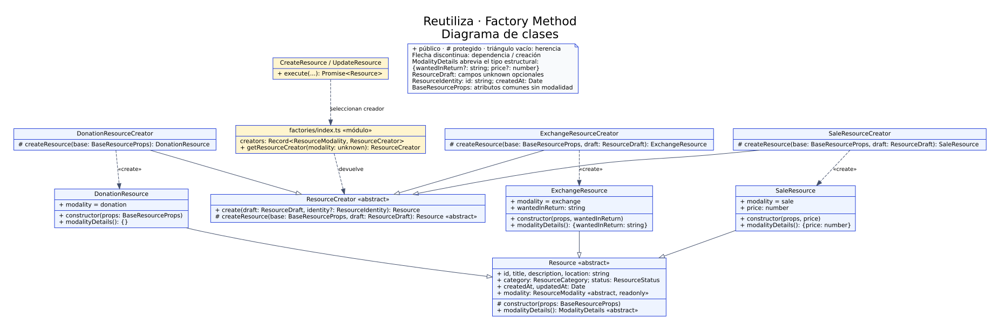
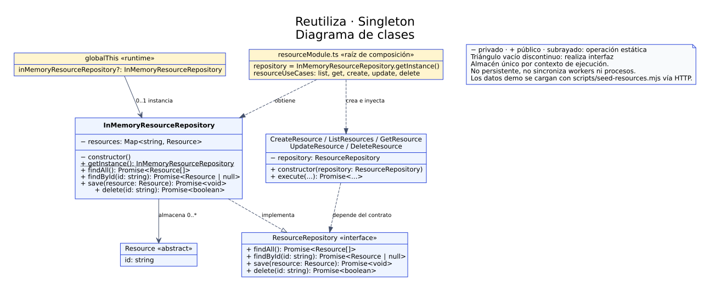

# Diagramas de clases UML

Los diagramas describen los participantes de Factory Method y Singleton y sus relaciones en el módulo de recursos de Reutiliza.

| Patrón | Fuente editable | Diagrama |
| --- | --- | --- |
| Factory Method | [factory-method.dot](factory-method.dot) | [SVG](factory-method.svg) |
| Singleton | [singleton.dot](singleton.dot) | [SVG](singleton.svg) |

## Factory Method

El creador abstracto establece el método de fábrica y las subclases construyen los productos de cada modalidad. Los casos de uso seleccionan un creador mediante el registro del módulo.



## Singleton

El repositorio implementa el contrato de almacenamiento y expone una operación estática para obtener la instancia compartida. La raíz de composición inyecta el repositorio en los casos de uso. Los datos de demostración se cargan desde un script separado mediante la API, no desde el repositorio.



## Notación

- `+` indica visibilidad pública; `#`, protegida; y `−`, privada.
- `«abstract»` identifica una abstracción y `«interface»`, una interfaz.
- El subrayado de `getInstance()` indica una operación estática.
- El triángulo vacío con línea continua representa herencia; con línea discontinua, realización de una interfaz.
- Las flechas discontinuas ordinarias representan dependencias; `«create»` especifica creación de instancias.

`ModalityDetails` abrevia el tipo estructural `{wantedInReturn?: string; price?: number}`. Los atributos de `Resource` son de solo lectura. Sus constructores concretos reciben `BaseResourceProps`; intercambio y venta añaden `wantedInReturn: string` y `price: number`, respectivamente.

Los casos de uso se agrupan para representar su dependencia común. Sus clases y archivos se detallan en el [informe técnico](../actividad-4.md). El retorno de `findById` admite `null`. La referencia compartida del repositorio se almacena en `globalThis`, con alcance limitado al contexto de ejecución.

## Generación de exportaciones

Las fuentes utilizan Graphviz DOT. Desde la raíz del proyecto, con Graphviz instalado:

```bash
dot -Tsvg docs/uml/factory-method.dot -o docs/uml/factory-method.svg
dot -Tsvg docs/uml/singleton.dot -o docs/uml/singleton.svg
```

El formato SVG conserva la legibilidad al ampliar el diagrama. Graphviz también permite exportar a PNG mediante la opción `-Tpng`.
