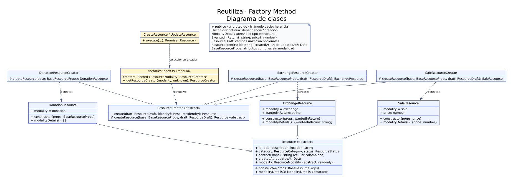
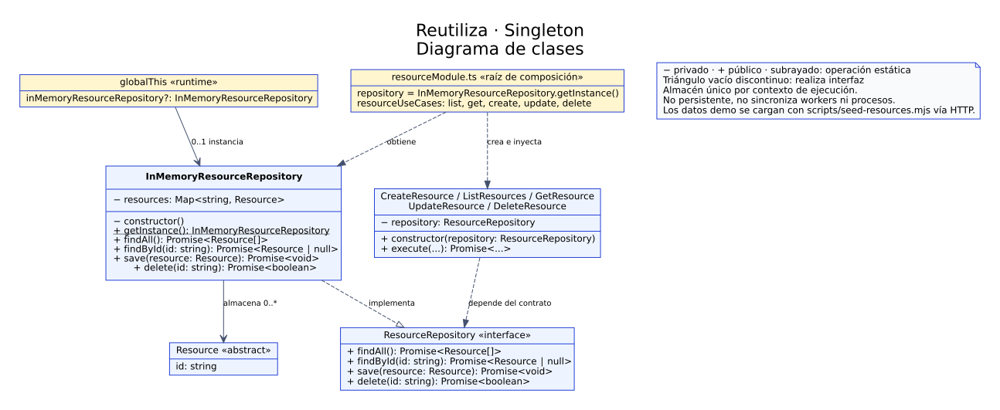
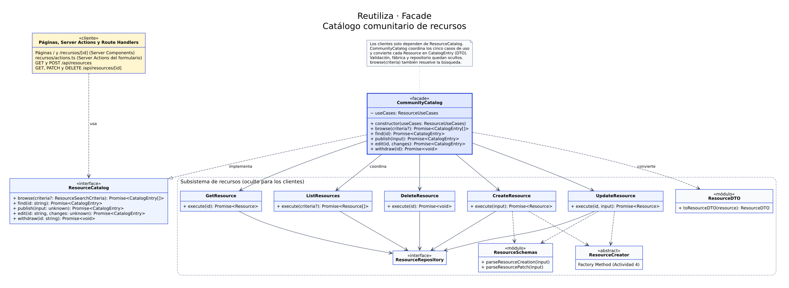
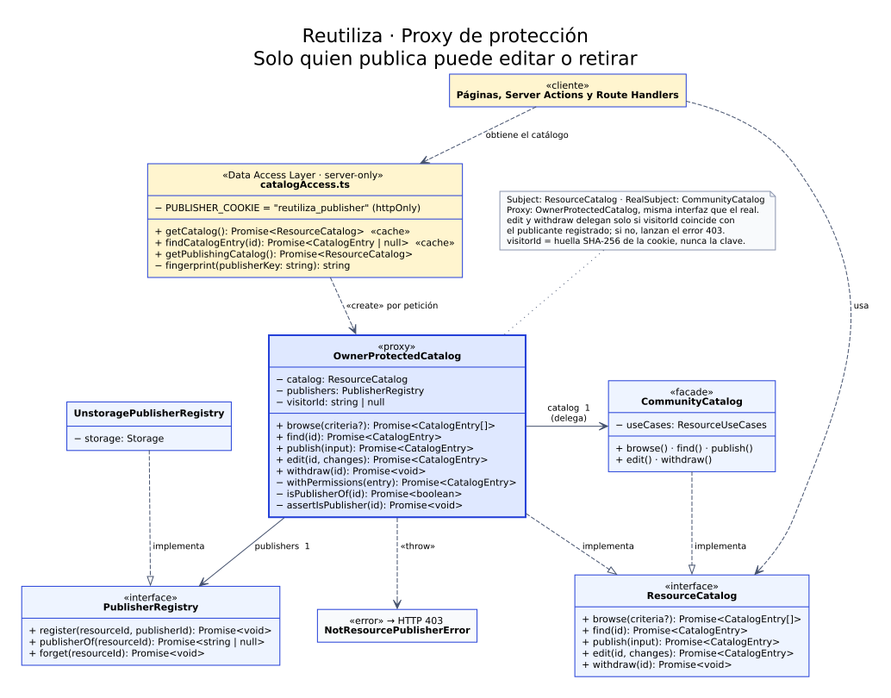
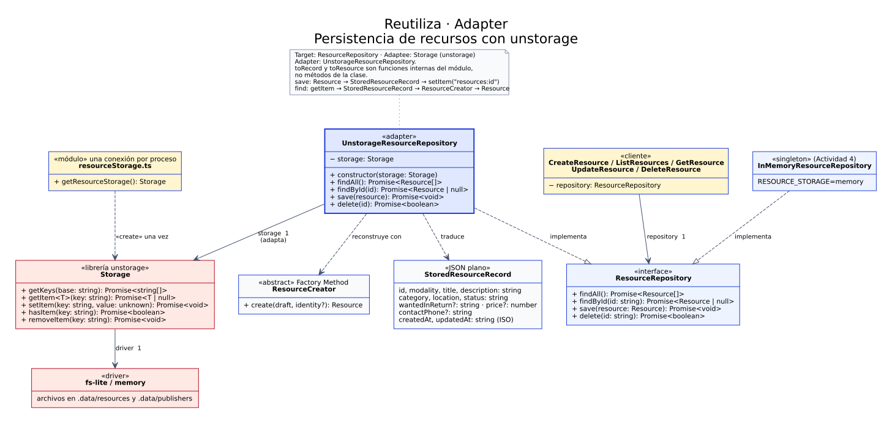
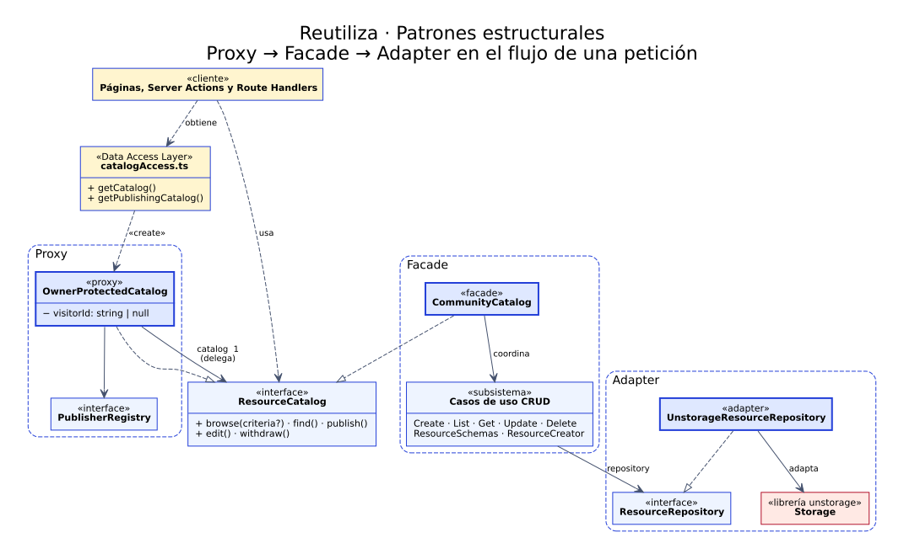

# Diagramas de clases UML

Los diagramas describen los participantes de los patrones creacionales (Factory Method y Singleton) y estructurales (Facade, Proxy y Adapter) y sus relaciones en el módulo de recursos de Reutiliza.

| Patrón | Fuente editable | Diagrama |
| --- | --- | --- |
| Factory Method | [factory-method.dot](factory-method.dot) | [SVG](factory-method.svg) |
| Singleton | [singleton.dot](singleton.dot) | [SVG](singleton.svg) |
| Facade | [facade.dot](facade.dot) | [SVG](facade.svg) |
| Proxy | [proxy.dot](proxy.dot) | [SVG](proxy.svg) |
| Adapter | [adapter.dot](adapter.dot) | [SVG](adapter.svg) |
| Facade, Proxy y Adapter integrados | [patrones-estructurales.dot](patrones-estructurales.dot) | [SVG](patrones-estructurales.svg) |

## Factory Method

El creador abstracto establece el método de fábrica y las subclases construyen los productos de cada modalidad. Los casos de uso seleccionan un creador mediante el registro del módulo.



## Singleton

El repositorio implementa el contrato de almacenamiento y expone una operación estática para obtener la instancia compartida. La raíz de composición inyecta el repositorio en los casos de uso. Los datos de demostración se cargan desde un script separado mediante la API, no desde el repositorio.



## Facade

`CommunityCatalog` ofrece a la página y a los Route Handlers cinco operaciones del catálogo y oculta los casos de uso, la validación, la fábrica, el repositorio y la conversión a DTO.



## Proxy

`OwnerProtectedCatalog` implementa la misma interfaz `ResourceCatalog` que la fachada y solo delega la edición y el retiro cuando el visitante es quien publicó el recurso. La Data Access Layer crea un proxy por petición con la huella de la cookie del visitante.



## Adapter

`UnstorageResourceRepository` hace que el almacén clave-valor de unstorage cumpla el contrato `ResourceRepository`. Traduce entidades a JSON plano y las reconstruye con el Factory Method.



## Patrones estructurales integrados



La justificación y la correspondencia de participantes se detallan en el [informe de patrones estructurales](../patrones-estructurales.md).

## Notación

- `+` indica visibilidad pública; `#`, protegida; y `−`, privada.
- `«abstract»` identifica una abstracción y `«interface»`, una interfaz.
- El subrayado de `getInstance()` indica una operación estática.
- El triángulo vacío con línea continua representa herencia; con línea discontinua, realización de una interfaz.
- Las flechas discontinuas ordinarias representan dependencias; `«create»` especifica creación de instancias y `«throw»`, el lanzamiento de un error.
- Las flechas continuas con punta abierta representan asociaciones; la etiqueta indica el atributo y su multiplicidad.
- En los diagramas estructurales, el participante principal de cada patrón tiene borde grueso; las clases de unstorage, ajenas al proyecto, aparecen en rojo.

`ModalityDetails` abrevia el tipo estructural `{wantedInReturn?: string; price?: number}`. Los atributos de `Resource` son de solo lectura. Sus constructores concretos reciben `BaseResourceProps`; intercambio y venta añaden `wantedInReturn: string` y `price: number`, respectivamente.

Los casos de uso se agrupan para representar su dependencia común. Sus clases y archivos se detallan en el [informe técnico](../actividad-4.md). El retorno de `findById` admite `null`. La referencia compartida del repositorio se almacena en `globalThis`, con alcance limitado al contexto de ejecución.

## Generación de exportaciones

Las fuentes utilizan Graphviz DOT. Desde la raíz del proyecto, con Graphviz instalado:

```bash
for diagram in factory-method singleton facade proxy adapter patrones-estructurales; do
  dot -Tsvg docs/uml/$diagram.dot -o docs/uml/$diagram.svg
done
```

Sin Graphviz instalado, las exportaciones pueden generarse con su versión WebAssembly para Node (`@hpcc-js/wasm-graphviz`), que es la que se usó para los diagramas estructurales.

El formato SVG conserva la legibilidad al ampliar el diagrama. Graphviz también permite exportar a PNG mediante la opción `-Tpng`.
