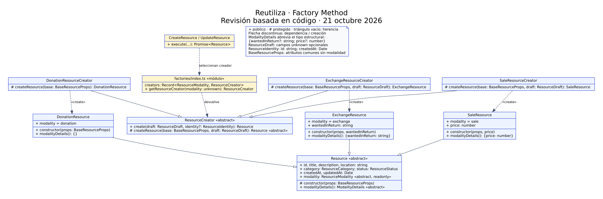
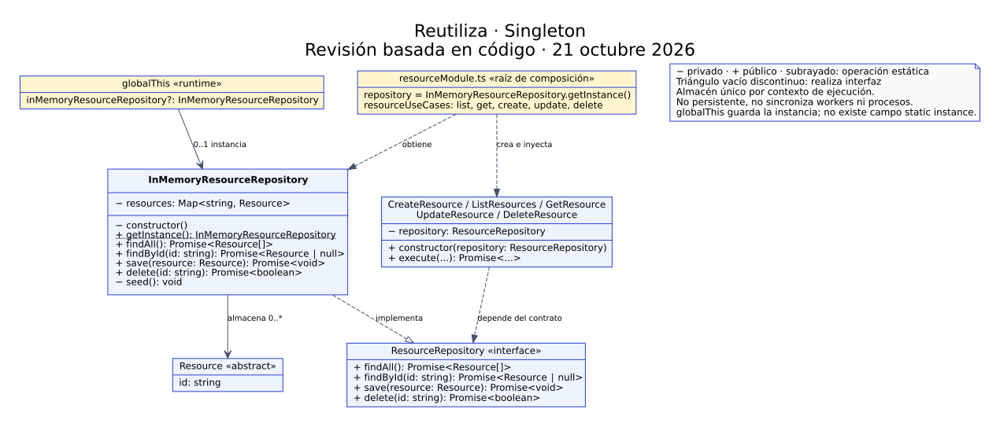

# UML · Revisiones basadas en implementación

Estos diagramas nuevos describen Factory Method y Singleton del código revisado. Se identifican como **revisiones**, porque la descarga soportada de los `.drawio` originales falló. Los originales no se han sobrescrito ni se afirma haber inspeccionado sus píxeles.

| Patrón | Fuente editable | Exportación |
| --- | --- | --- |
| Factory Method | [factory-method-revision.dot](factory-method-revision.dot) | [SVG](factory-method-revision.svg) |
| Singleton | [singleton-revision.dot](singleton-revision.dot) | [SVG](singleton-revision.svg) |





## Regenerar

Instalar Graphviz mediante el gestor habitual del equipo y ejecutar desde la raíz:

```bash
dot -Tsvg docs/uml/factory-method-revision.dot -o docs/uml/factory-method-revision.svg
dot -Tsvg docs/uml/singleton-revision.dot -o docs/uml/singleton-revision.svg
```

Para revisión en píxeles, usar `-Tpng` y abrir el resultado. Las exportaciones PNG de esta revisión se inspeccionaron: texto y flechas legibles, sin recortes. El SVG permite ampliar para leer todas las firmas.

## Convenciones y coherencia

- `+` público, `#` protegido, `−` privado; `«abstract»` indica abstracción.
- El subrayado identifica `getInstance()` como operación de clase; no se usa la notación incorrecta `$+getInstance()`.
- Triángulo vacío continuo: herencia. Discontinuo: realización de interfaz. Flechas discontinuas ordinarias: dependencia/creación.
- `ModalityDetails` es una abreviatura visual del tipo estructural `{wantedInReturn?: string; price?: number}`, no una clase añadida al código.
- Los atributos de `Resource` son de solo lectura. Los constructores concretos reciben `BaseResourceProps`; los de intercambio/venta también reciben `string`/`number`, respectivamente.
- Algunos clientes se agrupan para facilitar la lectura; sus clases y archivos se detallan en [Actividad 4](../actividad-4.md).
- `findById` conserva el retorno nullable. La referencia única está en `globalThis`, no en una propiedad estática `instance` inexistente.
